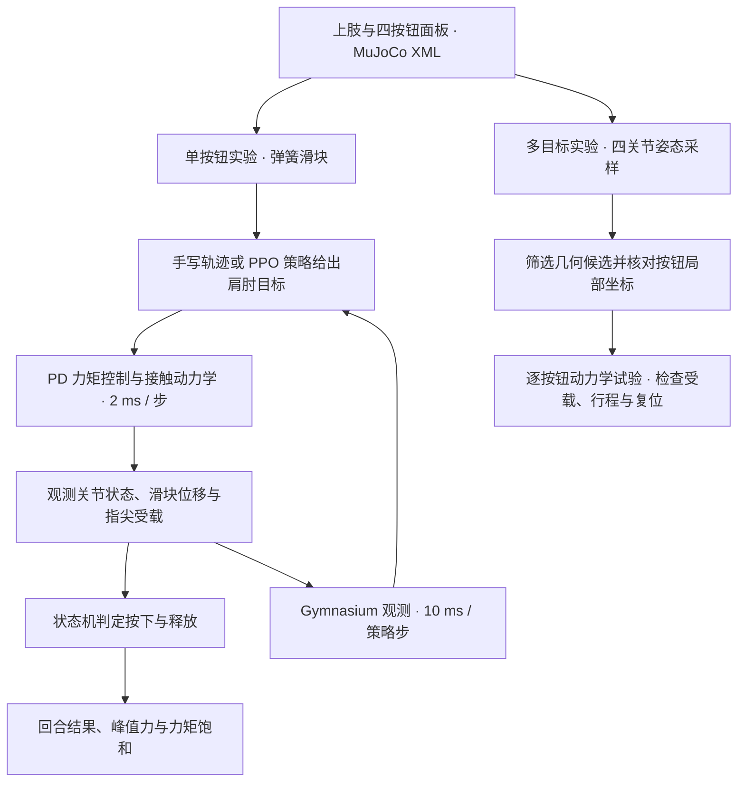
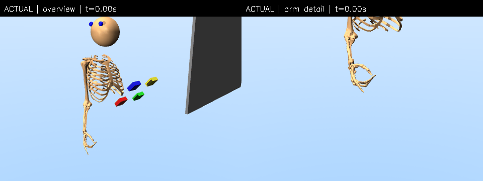
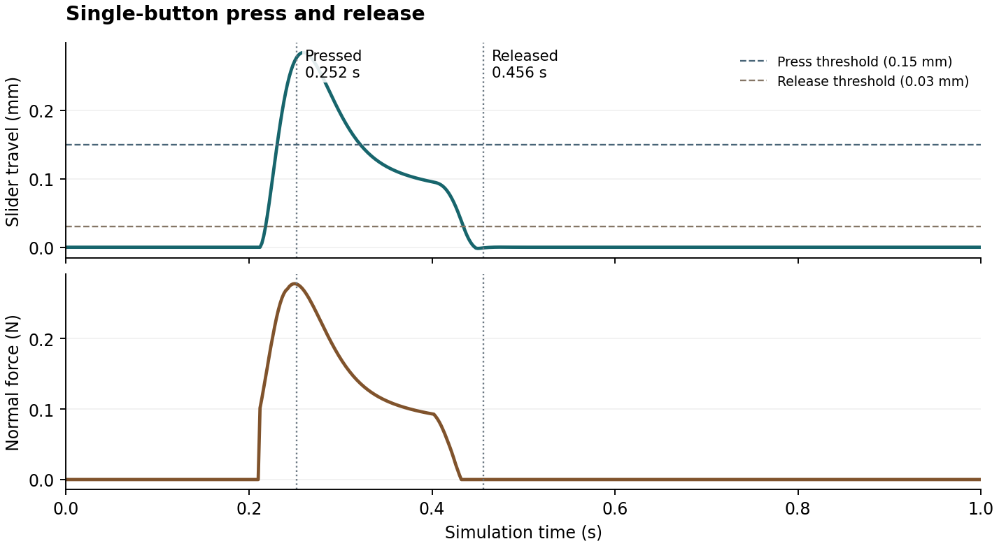

# 仿真上肢的面板按压控制与接触判定

*Simulating Upper-Limb Button Presses: Contact Dynamics and Policy Evaluation*

虚拟食指碰到按钮后，怎样判断它完成了一次按压？本课题在 MuJoCo 中模拟肩、肘和食指与面板的交互，同时观测接触力、滑块行程和释放时刻。研究沿两条路径展开：用单按钮实验检验闭环控制与事件判据，再用四按钮面板研究同一方法扩展到不同目标位置时遇到的几何和动力学问题。

## 方法



**图 1　实验设计。** 两条路径共用面板几何。单按钮实验在模型副本中加入滑块和肩肘力矩电机。多目标实验另行扫描肩部抬升、肩旋转和肘屈曲等四个自由度。



**图 2　肩肘双轴运动。** 两个固定视角重放同一组积分得到的关节位置。81 帧覆盖 4 秒仿真时间，供观察手臂姿态与指尖运动方向。[回放参数](artifacts/trajectory_check_2026-10-21/dual_motion_render.json)

## 单按钮实验

按下判据要求指尖与目标按钮持续受载，且滑块位移达到 0.15 mm；释放判据要求卸载，且位移回到 0.03 mm 以下。两个条件各需持续 20 ms。在图 3 的手写轨迹中，状态机于 0.252 s 登记按下，于 0.456 s 登记释放。这些阈值用于本实验的仿真滑块。[判定实现](mobl_arms_index_choice_reaction/button_press_state.py) · [逐步采样](artifacts/trajectory_check_2026-10-22/button_press_state_online.json)



**图 3　一次按压循环。** 上图为滑块位移，下图为指尖与目标按钮之间的法向接触力。竖线标出状态机事件。时间轴采用仿真时间。[制图脚本](scripts/plot_press_cycle.py)

PPO 每个训练种子运行 32,768 个策略步。三个策略各自在**同一组 50 个留出测试种子**上确定性评估，初始肩肘角扰动范围为 ±0.5°。表中峰值力先逐回合取最大值，再对 50 回合求均值；饱和计数按物理子步和电机通道累计。[训练与评估代码](mobl_arms_index_choice_reaction/train_ppo_multiseed.py) · [逐回合数据](artifacts/ppo_multiseed_2026-11-08/ppo_multiseed_report.json)

| 训练种子 | 成功回合 / 有效回合 | 平均峰值法向力（N） | 每回合平均饱和通道计数 |
| ---: | ---: | ---: | ---: |
| 2026 | 50 / 50 | 0.340 | 5.74 |
| 2027 | 50 / 50 | 0.340 | 5.92 |
| 2028 | 50 / 50 | 0.332 | 5.92 |

三个策略都完成了单按钮事件序列，也都出现过力矩截幅。成功率描述的是该滑块模型、初态范围和事件阈值下的表现。人体操作数据、实体按钮力学标定和跨目标泛化仍待验证。[质量阈值敏感性分析](artifacts/ppo_multiseed_2026-11-08/quality_threshold_sensitivity.json)

## 四按钮实验进度

| 研究问题 | 已有观测 | 当前结论 |
| --- | --- | --- |
| 食指网格能否到达各按钮？ | 四关节共扫描 106,561 个姿态，每个按钮均有几何距离 ≤ 0 的候选 | 四个位置均存在候选，部分姿态深度穿透 |
| 候选是否使指尖正对按钮？ | 另采样 500,000 个姿态，四个按钮通过正面筛选的计数均为 0 | 指尖标记点与末节碰撞网格采用不同参考位置，需用接触点复核 |
| 轨迹能否实现有效按压？ | 近表面候选中，按钮 0 未触及，按钮 1 滑块最大位移 6.07 mm，超过试验设定的 5 mm；按钮 2、3 无滑块位移 | 逐按钮的受载、按下与释放尚待验证 |

下一步是在按钮局部坐标系中检查 MuJoCo 的实际接触点 `contact.pos`，先对一个按钮确认正面接近、受载和复位，再扩展目标条件策略。[四关节扫描](artifacts/trajectory_check_2026-11-08/button_reachability_multidof.json) · [正面筛选](artifacts/trajectory_check_2026-11-08/face_aligned_candidates.json) · [动态试验](artifacts/trajectory_check_2026-11-08/four_joint_slider_dynamics_slow_pd.json)

## 复现入口

以下命令从仓库根目录运行，使用 Python 3.10。基础面板实验可在无摄像头、无 ROS 2 的环境中运行。

```bash
git clone https://github.com/lbxlb/HCL_interaction_task.git
cd HCL_interaction_task
python -m pip install -r mobl_arms_index_choice_reaction/requirements.txt
python mobl_arms_index_choice_reaction/main.py --headless --max-steps 20
python mobl_arms_index_choice_reaction/test_button_press_state.py
```

第一条运行命令应输出累计 20 个物理步、0.040000 秒仿真时间。状态机测试覆盖事件顺序、阈值和非法输入。单按钮环境验证、PPO 复训与图表重建见[实验复现指南](docs/reproduction.md)。

## 仓库导航

| 目录 | 内容 |
| --- | --- |
| [面板实验](mobl_arms_index_choice_reaction/) | 主模型与网格、任务状态机、Gymnasium 环境、控制与训练脚本 |
| [指向实验](mobl_arms_index_pointing/) | 指向模型、摄像头手势演示和独立的 ROS 2 示例工作区 |
| [ROS 2 采集示例](ros2_ws/src/mujoco_ros_demo/) | 关节状态发布、订阅与仿真数据采集 |
| [实验产物](artifacts/) | 按实验与日期组织的轨迹、诊断报告和策略权重 |
| [复现实验](docs/reproduction.md) · [制图代码](scripts/) | 实验入口、环境依赖与结果图生成方式 |

## 英文参考文献

1. Ikkala, A., et al. (2022). *Breathing Life Into Biomechanical User Models*. UIST. 该工作提出 User-in-the-Box，为本课题的上肢交互建模提供背景。[论文](https://doi.org/10.1145/3526113.3545689) · [上游项目](https://github.com/User-in-the-Box/user-in-the-box)
2. Todorov, E., Erez, T., & Tassa, Y. (2012). *MuJoCo: A Physics Engine for Model-Based Control*. IEEE/RSJ IROS. 本课题采用其多关节动力学与接触求解器。[论文](https://doi.org/10.1109/IROS.2012.6386109)
3. Schulman, J., Wolski, F., Dhariwal, P., Radford, A., & Klimov, O. (2017). *Proximal Policy Optimization Algorithms*. 本课题使用 PPO 训练单按钮控制策略。[论文](https://arxiv.org/abs/1707.06347)

项目代码沿用 Apache License 2.0。[许可证](LICENSE)
